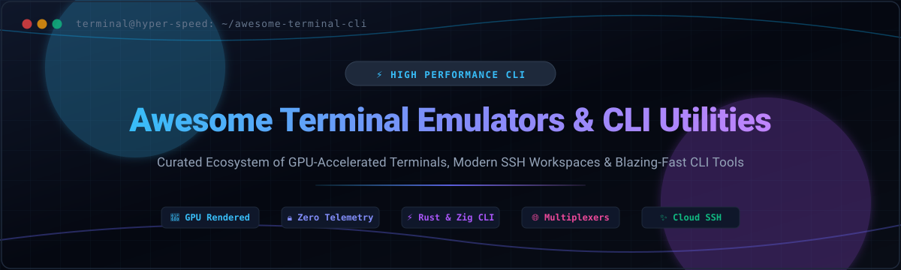

# Awesome Terminal Emulator & CLI Utilities ⚡

  

  
  
  
  
  
  

---

## 📖 Executive Summary & Scope

Welcome to the definitive, search-optimized index for the **modern terminal emulator and command-line interface (CLI) utilities ecosystem**. Whether you are building high-throughput systems, orchestrating cloud clusters, or seeking pixel-perfect developer ergonomics, this repository curates the best **GPU-accelerated terminal emulators**, **cloud-synced SSH client workspaces**, **terminal multiplexers**, and modern **Rust/Go/Zig CLI replacements** for traditional Unix tools.

### 🌟 Key Highlights
* 🚀 **GPU-Accelerated Performance**: Low-latency hardware rendering powered by Vulkan, Metal, OpenGL, and DirectX (DirectWrite).
* 🔒 **Zero Telemetry & High Privacy**: Native open-source utilities built for confidential environments and local execution.
* 🤖 **AI-Enhanced & Cloud Shells**: Modern block-based terminal workflows, integrated AI assistants, and team credentials sync.
* ⚡ **Next-Gen CLI Replacements**: Lightning-fast alternatives to `cat`, `ls`, `grep`, `find`, `cd`, `ps`, and `top`.

---

## 📑 Table of Contents
* [📊 Sector Overview & Market Dynamics](#-sector-overview--market-dynamics)
* [☁️ SaaS & Hosted Platforms](#️-saas--hosted-platforms)
* [💻 Open-Source GitHub Projects](#-open-source-github-projects)
* [💡 Modern CLI Utilities & Replacements](#-modern-cli-utilities--replacements)
* [🤝 How to Contribute](#-how-to-contribute)
* [☕ Support](#-support)
* [📈 Star History](#-star-history)
* [📜 Disclaimer](#-disclaimer)

---

## 📊 Sector Overview & Market Dynamics

The global **Terminal Emulator and CLI Access Software market** is estimated at **$2.8 billion to $4.2 billion**, with forecasts projecting growth beyond **$8.5 billion by 2032** at a Compound Annual Growth Rate (CAGR) of **6.7% to 11.2%**, propelled by enterprise cloud migration, distributed DevOps engineering, and infrastructure modernizations.

The sector is **moderately fragmented**: enterprise host connectivity, legacy mainframe bridging (IBM 3270/5250), and regulated corporate remote administration are dominated by established legacy incumbents (such as Micro Focus/OpenText, Rocket Software, and VanDyke Software), whereas the high-growth developer and cloud-native workstation segment is fiercely contested by agile VC-funded AI-native innovators (like Warp), collaborative SSH platforms (like Termius), and a hyper-active open-source ecosystem that frequently sets cutting-edge rendering standards.

---

## ☁️ SaaS & Hosted Platforms

Below is a curated comparison of leading commercial and cloud-hosted terminal workspaces, ranked in descending order by estimated company valuation / annual revenue scale.

| Platform | Description | Starting Tier Price | Free Tier / Trial Limits | Company Scale (Valuation / Est. Revenue) |
| :--- | :--- | :--- | :--- | :--- |
| **[Warp](https://warp.dev)** | Modern Rust-based, GPU-accelerated terminal featuring command blocks, team shared workflows (Warp Drive), and integrated AI assistant. | **$12/user/month** (Team plan, billed annually) | **Perpetual Free Tier**: Unlimited core terminal usage on macOS/Linux/Windows, 0 bundled AI credits (Bring-Your-Own-Key allowed for individuals/teams ≤10), personal command history sync. | **$290M+ Valuation** (~$73M–$85M total funding raised) |
| **[Termius](https://termius.com)** | Cross-platform SSH/SFTP workspace with hardware key authentication, port forwarding, and team vault synchronization. | **$10/user/month** (Pro plan, billed annually) | **Perpetual Free Tier (Starter)**: 1 device local vault, basic SSH/SFTP client, terminal autocomplete. (14-day free trial available for multi-device Pro sync). | **~$40M+ Est. Valuation** ($4.1M+ Seed funding; est. $5M–$10M ARR) |
| **[SecureCRT](https://vandyke.com)** | Enterprise-grade rock-solid SSH, Telnet, and serial terminal emulator from VanDyke Software with advanced session management. | **$119.00 perpetual** (1 user standalone license with 1-year updates) | **30-day Free Trial**: Fully functional evaluation license with complete feature access and email technical support included. | **~$1.9M–$2.5M Annual Revenue** (~15–25 employees, bootstrapped) |
| **[Xshell](https://netsarang.com)** | Industry-standard Windows SSH/SFTP terminal emulator from NetSarang Computer with dynamic port forwarding and multi-tab scripts. | **$119.00 perpetual** (Single user commercial license with 1-year maintenance) | **Free for Personal/School Use**: Permanent non-commercial license for up to 3 personal devices; 30-day free evaluation trial for commercial auditing. | **~$330K–$1M Annual Revenue** (~10–20 employees) |
| **[ShellNGN](https://shellngn.com)** | Cloud-native web-based terminal client for managing SSH, SFTP, VNC, and RDP sessions directly from any web browser. | **$3.25/month** (Cloud Basic plan, billed annually) | **30-day Free Trial**: Up to 3 saved servers, 1 active concurrent SSH session, 1 SFTP session, and 1 RDP/VNC session (no credit card required). | **Micro-SaaS / Indie** (<$250K Annual Revenue, private) |

---

## 💻 Open-Source GitHub Projects

Curated list of standout open-source terminal emulators and CLI multiplexers, sorted in descending order by GitHub Stars_Count ⭐.

| Project | GitHub_Stars | Language | Primary Focus & Capabilities |
| :--- | :---: | :---: | :--- |
| **[Windows Terminal](https://github.com/microsoft/terminal)** |  | C++ | Modern, high-performance terminal for Windows with GPU text rendering (DirectWrite), tabs, split panes, and quake mode. |
| **[Tabby](https://github.com/Eugeny/tabby)** |  | TypeScript | Infinitely customizable cross-platform terminal, SSH, and serial client with integrated SFTP and rich plugin ecosystem. |
| **[Alacritty](https://github.com/alacritty/alacritty)** |  | Rust | Minimalist, blazing-fast GPU-accelerated terminal emulator focused strictly on speed, performance, and simplicity. |
| **[Ghostty](https://github.com/ghostty-org/ghostty)** |  | Zig | Fast, feature-rich cross-platform terminal utilizing native OS platform UI (Metal/GTK) alongside GPU rendering and Kitty graphics protocol. |
| **[tmux](https://github.com/tmux/tmux)** |  | C | The battle-tested terminal multiplexer standard for managing multiple sessions, splitting windows, and persistent remote SSH resilience. |
| **[Hyper](https://github.com/vercel/hyper)** |  | JavaScript | Highly extensible Electron-based terminal built on web standards with a thriving community theme and extension marketplace. |
| **[Zellij](https://github.com/zellij-org/zellij)** |  | Rust | Ergonomic, batteries-included terminal workspace and multiplexer featuring customizable layouts, floating panes, and WebAssembly plugins. |
| **[Kitty](https://github.com/kovidgoyal/kitty)** |  | C / Python | GPU-accelerated terminal with comprehensive Kitty graphics protocol support, true color, ligatures, tiling layouts, and extensible kittens. |
| **[WezTerm](https://github.com/wez/wezterm)** |  | Rust | GPU-accelerated cross-platform terminal and multiplexer configured via Lua, featuring native SSH client domains and split panes. |
| **[Wave Terminal](https://github.com/wavetermdev/waveterm)** |  | Go / TypeScript | Open-source, AI-native terminal workspace embedding rich graphical web widgets, inline file previews, and isolated persistent SSH sessions. |
| **[iTerm2](https://github.com/gnachman/iTerm2)** |  | Objective-C | The venerable gold-standard terminal for macOS featuring hotkey dropdown windows, inline images, shell integrations, and Python scripting. |
| **[Rio](https://github.com/raphamorim/rio)** |  | Rust | Next-generation hardware-accelerated terminal emulator built with WebGPU, designed to run natively on desktop and inside browsers via WASM. |
| **[OxideTerm](https://github.com/AnalyseDeCircuit/oxideterm)** |  | Rust | High-performance, GPU-rendered workspace built in Rust & GPUI for local shells, remote SSH/SFTP, MCP tools, with zero WebView and zero telemetry. |

---

## 💡 Modern CLI Utilities & Replacements

Supercharge your terminal workflow with modern, active open-source command-line utilities that replace traditional coreutils with enhanced ergonomics and blistering speed, sorted in descending order by GitHub Stars_Count ⭐.

| Utility | GitHub_Stars | Replacement For | Highlights |
| :--- | :---: | :---: | :--- |
| **[fzf](https://github.com/junegunn/fzf)** |  | Interactive Search | Blazing-fast interactive command-line fuzzy finder for commands, files, history, git commits, and shell keybindings. |
| **[lazygit](https://github.com/jesseduffield/lazygit)** |  | Git CLI wrapper | Intuitive, full-featured terminal UI for git commands that simplifies staging, rebasing, stash management, and branch merging. |
| **[ripgrep (rg)](https://github.com/BurntSushi/ripgrep)** |  | `grep` | World-class line-oriented recursive regex search tool that respects `.gitignore` rules and skips binary files by default. |
| **[bat](https://github.com/sharkdp/bat)** |  | `cat` | Cat clone with syntax highlighting for dozens of programming languages, Git diff status integration, and automatic paging. |
| **[Starship](https://github.com/starship/starship)** |  | Shell Prompt | Fast, minimal, and customizable prompt for Bash, Zsh, Fish, PowerShell, and Nushell displaying contextual status indicators. |
| **[fd](https://github.com/sharkdp/fd)** |  | `find` | Fast, user-friendly alternative to `find` with colored output, regex pattern matching, parallel directory walking, and smart case sensitivity. |
| **[zoxide](https://github.com/ajeetdsouza/zoxide)** |  | `cd` | Intelligent directory jumper written in Rust that remembers your most accessed folders and navigates with a single keypress. |
| **[btop](https://github.com/aristocratos/btop)** |  | `top` / `htop` | Highly responsive monitor showing processor, memory, disks, network, and process hierarchies with real-time responsive graphs. |
| **[delta](https://github.com/dandavison/delta)** |  | `diff` / git pager | Syntax-highlighting pager for git, diff, and grep output with side-by-side split diff views and line-level word diffs. |
| **[Atuin](https://github.com/atuinsh/atuin)** |  | `history` | Shell history stored in an encrypted SQLite database with end-to-end multi-machine synchronization and fuzzy search. |
| **[glow](https://github.com/charmbracelet/glow)** |  | Markdown viewer | Terminal-based Markdown reader with GitHub Flavored Markdown parsing, custom styling themes, and pager navigation. |
| **[eza](https://github.com/eza-community/eza)** |  | `ls` | Actively maintained fork of exa featuring file type icons, tree views, Git status indicators, and human-readable metadata. |
| **[bottom](https://github.com/ClementTsang/bottom)** |  | `top` / Activity Monitor | Cross-platform graphical process and system monitor written in Rust with configurable visual dashboard widgets. |
| **[dust](https://github.com/bootandy/dust)** |  | `du` | Intuitive disk usage analyzer presenting a visual breakdown of large directories directly in your terminal window. |
| **[tealdeer](https://github.com/dbrgn/tealdeer)** |  | `man` / `tldr` | Blazingly fast Rust implementation of `tldr` command pages providing concise, practical, everyday usage examples. |
| **[procs](https://github.com/dalance/procs)** |  | `ps` | Modern replacement for `ps` with color highlighting, Docker container name display, TCP/UDP port mapping, and tree view. |

---

## 🛠️ Recommended Developer Stacks

Looking to assemble the ultimate terminal workflow? Here are three proven, high-performance setups:

* **⚡ Pure Rust & Speed Stack**: `Alacritty` or `Rio` + `Zellij` + `Starship` + `ripgrep` + `fd` + `bat` + `eza` + `zoxide`
* **🎨 Modern Visual & Ligatures Stack**: `Ghostty` or `Kitty` + `tmux` + `Starship` + `fzf` + `delta` + `btop` + `lazygit`
* **🌐 Enterprise Multi-Host & SSH Stack**: `Termius` or `Warp` or `OxideTerm` + `Atuin` + `tealdeer` + `dust` + `bottom`

---

## 🤝 How to Contribute

Contributions are warmly encouraged! To propose a new terminal emulator, SSH workspace, or modern CLI tool:

1. 🍴 **Fork the repository**.
2. 🌿 **Create a new branch**: `git checkout -b feature/add-new-tool`.
3. 📝 **Add your entry**: Follow the existing Markdown table format with accurate details, active links, and Stars_Badges.
4. ✅ **Ensure accuracy**: Verify that URLs point to official repositories or sites and descriptions remain concise and objective.
5. 🚀 **Submit a Pull Request** with a brief summary of the added project.

---

## ☕ Support

If you find this curated ecosystem directory helpful in supercharging your developer productivity, please consider supporting the project:

* ⭐ **Star this repository** to help other developers discover modern CLI tools.
* 🍴 **Fork and share** the repo with your developer community, team, or homelab group.
* ☕ **Buy a coffee & sponsor**: Support continuous maintenance and research via the [GitHub Sponsor Dashboard](https://github.com/sponsors/ishandutta2007).

Thank you for being part of the open-source terminal community! 🚀

---

## 📈 Star History

---

## 📜 Disclaimer

* This list is a **community-curated index** provided for informational purposes; inclusion does not constitute a formal commercial endorsement.
* Always audit SSH configuration, cryptographic keychains, telemetry flags, and access permissions when deploying terminal utilities on production machines or multi-tenant servers.
* GPU-accelerated terminal emulators require compatible GPU drivers (Vulkan, Metal, DirectX, or OpenGL) for optimal throughput and low input latency.

---

  <b>Built with ❤️ for terminal power users, sysadmins, DevOps engineers, and open-source creators worldwide.</b>

